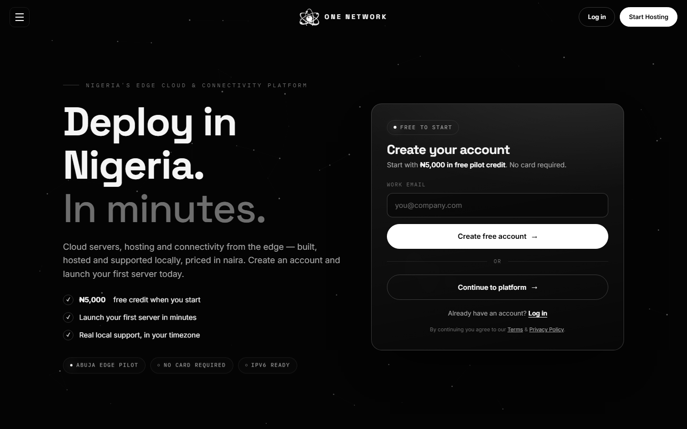

# Projects I've built and managed

Each of these is a real product I delivered for a business, taken from an idea
through to something live that people use. I tend to own the whole thing, the
interface, the API behind it, the database, and the servers it runs on, and I
stay on to run and improve it after launch.

Day to day that's TypeScript and React on the front, Node on the back, and
whatever a project needs underneath (Cloudflare Workers with D1, Postgres, some
Python, Caddy and Proxmox on the server side).

Readable code lives in a separate repo: [hmg-website](https://github.com/theonenetworknigeria-source/hmg-website),
a single page site with no framework and no build step. I'm happy to walk
through any of the others on a call.

---

### 1OFFICE
Live: https://1office.onenetwork.ng/welcome/

A full business suite for small companies under one login: mail on your own
domain, documents, spreadsheets, slides, a CRM, invoicing, payroll, a staff
rota module, and internet calling. React and TypeScript on the front, Node on
the back, with real time co-editing. The spreadsheet runs its own formula
engine of around 150 functions, and the documents and slides export to Word,
PDF and PowerPoint. Built and run for the business, with real companies on it.

### Forecastera
An economic scenario tool built for a client. A chat you can ask questions in,
plus a one page model that runs the numbers and charts them. I built the
interface and the simulation layer.

### ENTERPRO
A procurement and engineering suite delivered for a client. The structural side
is the part I'm proudest of: section properties, code checks, a clash check,
and export to IFC and DXF, with a 3D view of the layout.

### One Network
The hosting and infrastructure side: customer virtual machines and websites
running on OVH servers that I set up and manage, with the control panel,
firewalls and backups behind them.

### Urban Culture
Live: https://laurbanculture.com

A culture and media site with a members area and a shop layer, built and run
for the brand. Cloudflare Workers with D1, passwordless sign in, orders and
consent kept in the database.

### The Last Avenue
A property and lettings platform delivered for the business, site plus its own
API layer.

### IRIS
An assistant built for the group that writes documents, drafts mail and turns
plain requests into actions, with model routing behind it so simple questions
go to a cheaper model and harder ones go to a stronger one.

### More
- [HMG](https://theonenetworknigeria-source.github.io/hmg-website/), an editorial site for a holding group (the code is public, linked above).
- [SPREE](https://spree.onenetwork.ng), a browser multiplayer game running on its own server.
- [Refresh & Co](https://refreshandco.com), a site with a private operations dashboard behind it for stock, sales and partner payouts.
- [MTB Cutz](https://mtb.onenetwork.ng), a booking site for a barber.

---

A lot of this stays private because it holds real customer data and payment
keys. If you want to see how a particular one is built, ask and I'll show you.
