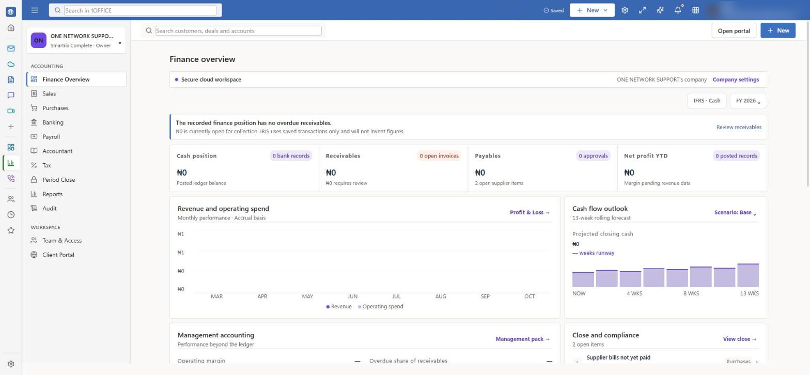
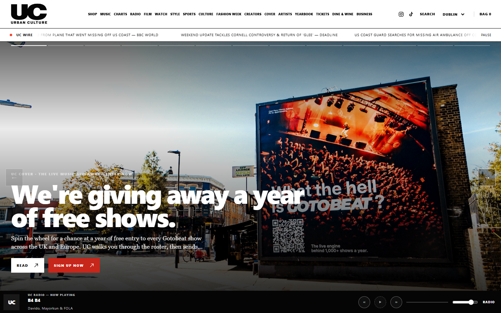
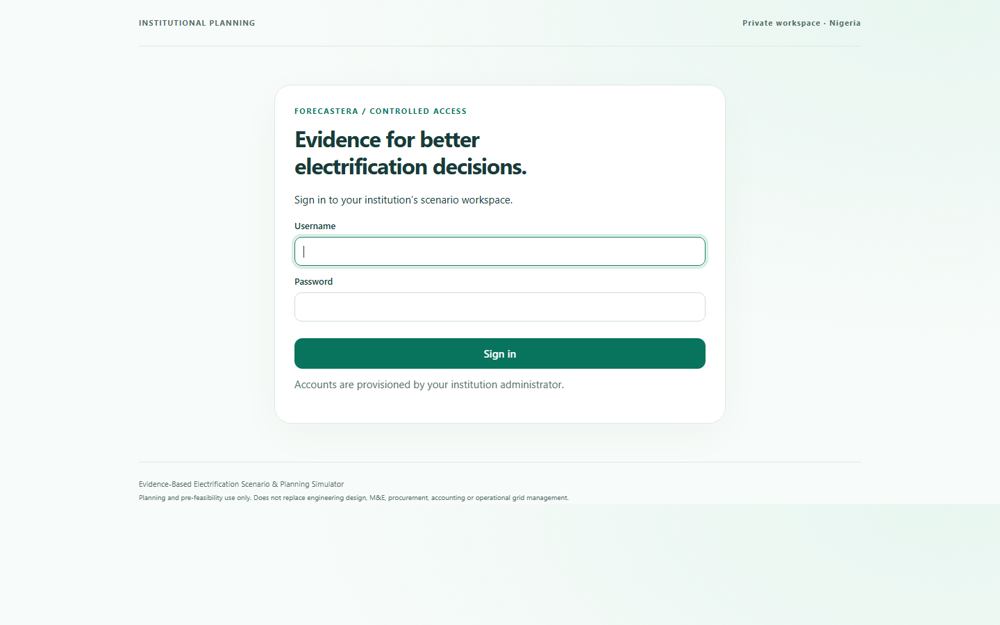
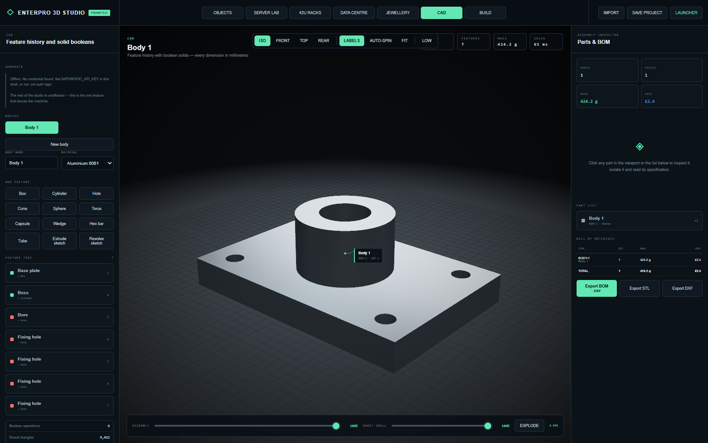
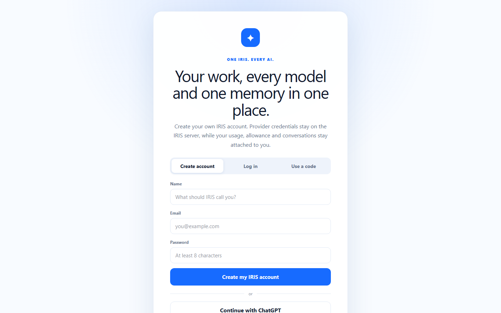
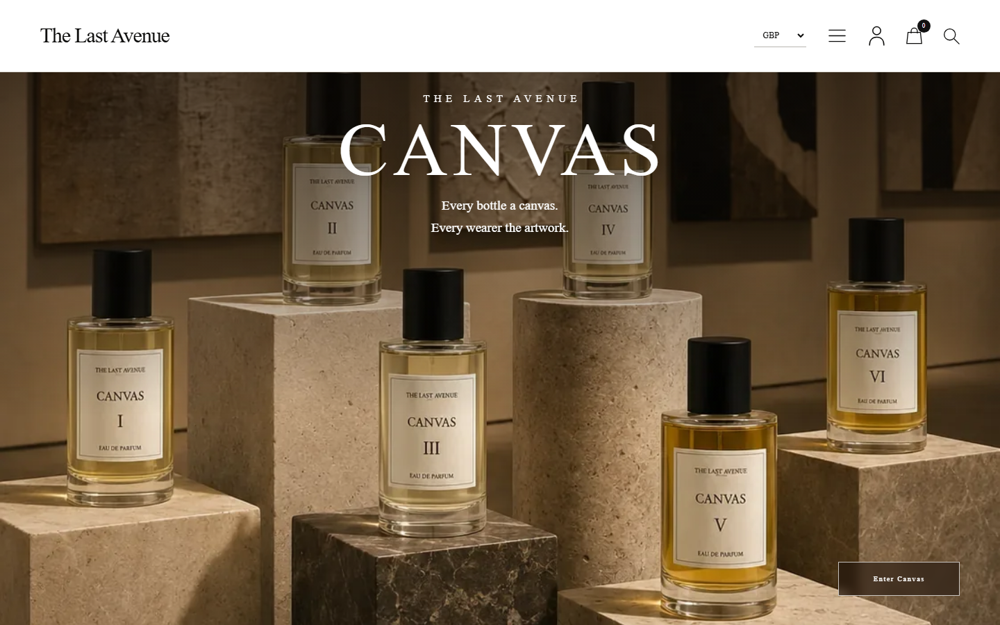

# Things I've built

Most of these are live. The links go to the real product, not a mockup.

I usually build the whole thing rather than one slice of it: the interface, the
API behind it, the database, and the deploy. Day to day that's TypeScript and
React on the front, Node on the back, and whatever a given project needs
underneath (Cloudflare Workers with D1, Postgres, a bit of Python, Caddy and
Proxmox for the servers).

Code you can actually read is in a separate repo: [hmg-website](https://github.com/theonenetworknigeria-source/hmg-website)
(a single-page site, no framework, no build step). Happy to walk through any of
the rest on a call.

---

### 1OFFICE — business suite
Live: https://1office.onenetwork.ng/welcome/

The big one. One login to run a small business: mail on your own domain,
documents, spreadsheets, slides, a CRM, invoicing, payroll, a staff rota
module, and internet calling. React and TypeScript on the front, Node on the
back, real-time co-editing over a small sync layer. The spreadsheet has its own
formula engine (around 150 functions, including lookups and finance), and the
documents and slides export to Word, PDF and PowerPoint. It has real companies
using it.

### Urban Culture
Live: https://laurbanculture.com

A culture and media site with a members area and a shop layer. Runs on
Cloudflare Workers with D1 (SQLite at the edge), passwordless sign in, orders
and consent tracked in the database.

### Forecastera
An economic scenario simulator: a chat you can ask questions in, and a
one-page model that runs the numbers and charts them. Built the UI and the
simulation layer.

### ENTERPRO
A procurement and engineering suite. The part I'm proudest of is the
structural side: section properties, code checks, a clash check, and export to
IFC and DXF, with a 3D view of the layout.

### IRIS
An assistant that writes documents, drafts mail, and turns plain requests into
actions, with model routing behind it so simple questions go to a cheap model
and hard ones go to a stronger one.

### The Last Avenue
Property and lettings site with its own API layer.

### SPREE
Live: https://spree.onenetwork.ng

A browser multiplayer shooter. Runs on a box behind Caddy with its own game
server.

### A few smaller ones
- [HMG](https://theonenetworknigeria-source.github.io/hmg-website/) — editorial site for a holding group (code is public, linked above).
- [Refresh & Co](https://refreshandco.com) — site and a private ops dashboard behind it for stock, sales and partner payouts.
- [MTB Cutz](https://mtb.onenetwork.ng) — a barber's booking site.
- One Network — the hosting side: customer VMs and sites on OVH servers I set up and run.

---

Not everything is public, because a lot of it holds real customer data and
payment keys, so the source stays private. If you want to see how something is
built, ask and I'll show you.
